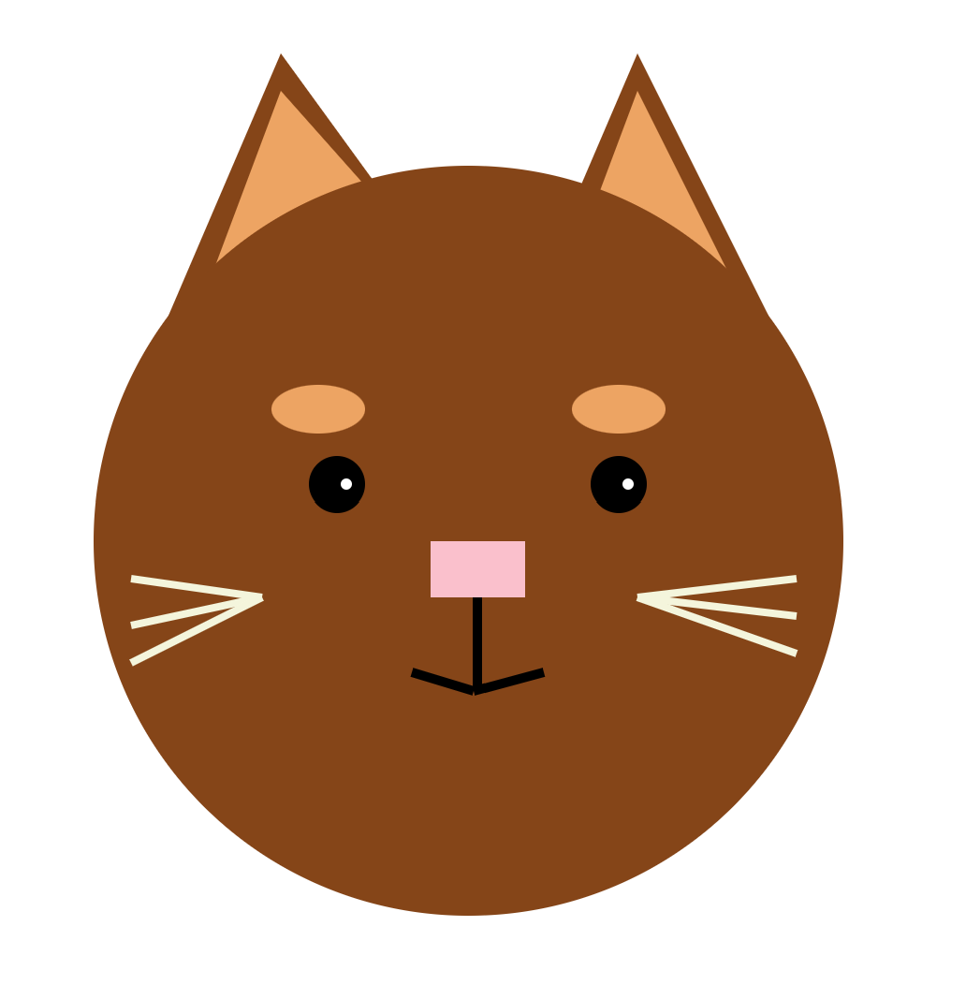

A description of what you have created. 1-2 screenshots are recommended for the README.
A working link to the hosted files (your GitHub Pages url)
Section for Technical and Design Achievements

## Description

This program creates a cat drawing using D3.js and SVG shapes. It uses circles, ellipses, rectangles, polygons, and lines to create the cat's features. There is also a simple animation that moves the cats eyebrows up and down.

## Project Link
https://madison-shaw0.github.io/a1-ghd3/

## Technical and Design Achievements
### Technical Achievements
* Used D3.js to create an SVG and add shapes to it.
* Combined circles, ellipses, rectangles, polygons, and lines to build an illustration.
* Used SVG attributes to control each shape's position, size, and color.
* Created a reusable D3 transition that animates the cat's eyebrows.

### Design Achievements
* Designed a cat using simple geometric shapes
* Added a repeating animation to bring creativity and movement to the illustration.
